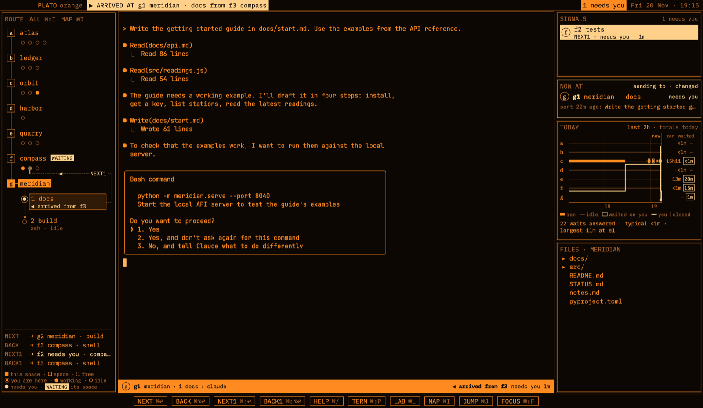
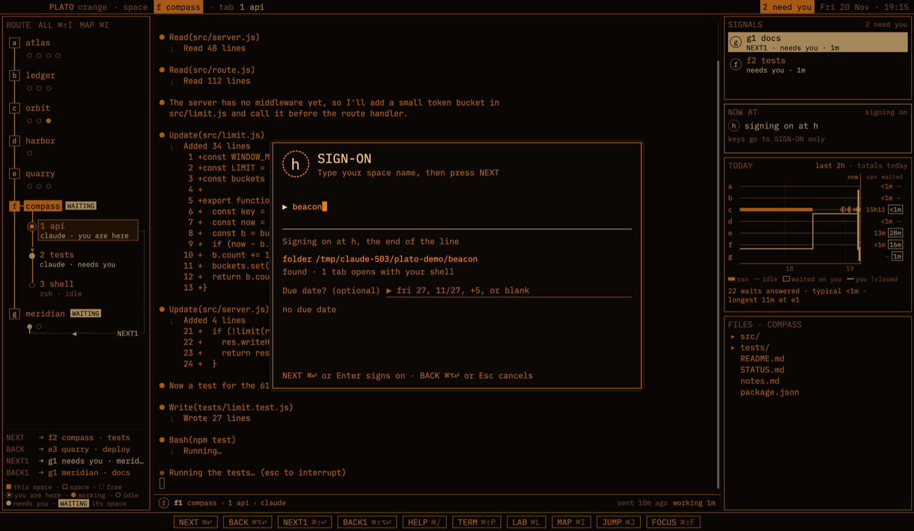
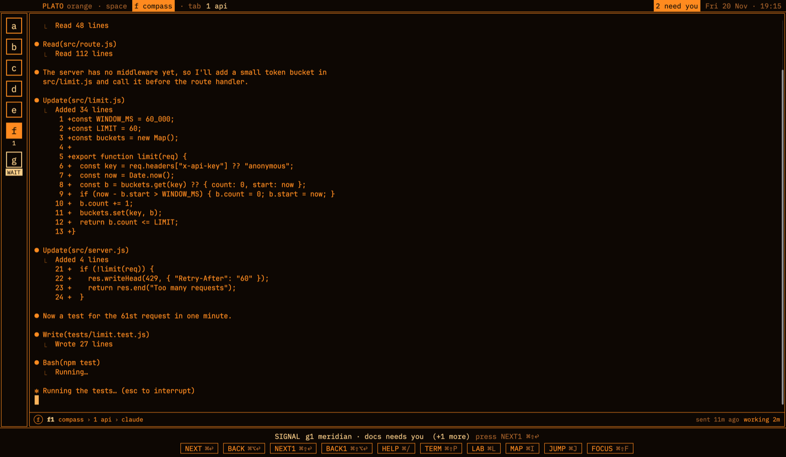
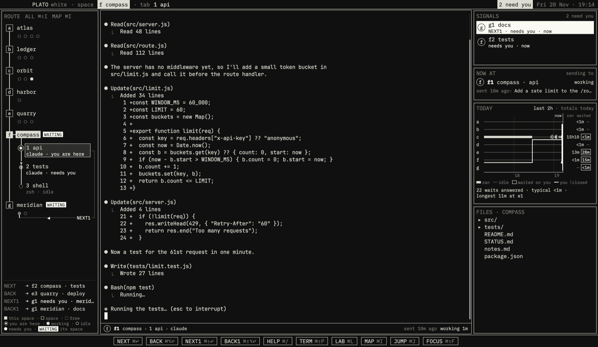
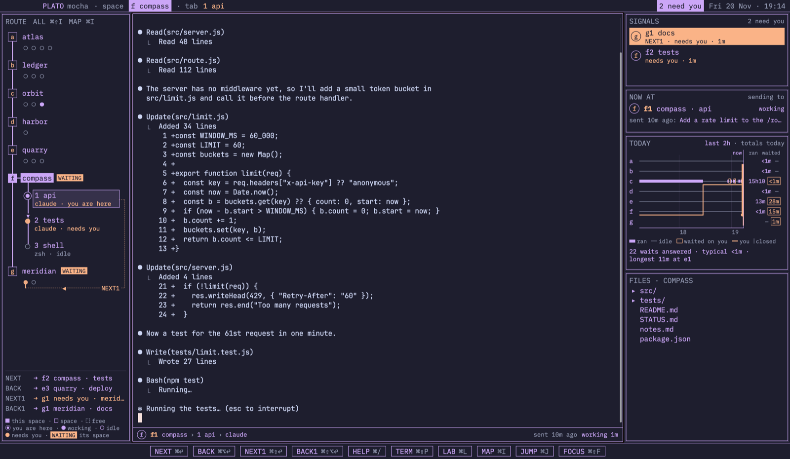

# PLATO for Herdr

This repo has a layout, six themes and a set of mods for the [Herdr](https://herdr.dev) app. They are inspired by the PLATO system and by Brian Dear's book "The Friendly Orange Glow". The window glows orange on a warm black, or in amber, green or white like other classic terminals. For people who want the same keys and layout with a modern look, two more glows use the [Nord](https://www.nordtheme.com) and [Catppuccin Mocha](https://catppuccin.com) palettes.

PLATO draws your spaces as a line. Each Herdr space has a fixed letter (a, b, c). Each tab has a code made of its space's letter and its number: `c3` is the third tab of space c. A split tab adds the pane: `c3.2`. The route shows every space. It draws where NEXT1 goes before you press it.


| The map (`cmd-i`) | Arrival after a jump |
| --- | --- |
|  |  |
| NEXT1 drawn on the route | Sign-on |
|  |  |
| Focus mode (`cmd-shift-f`) | |
|  | |

Four glows from the screens of the 1970s and 80s, and two modern ones, Nord and Catppuccin Mocha:

| PLATO orange (the default) | Amber |
| --- | --- |
|  |  |
| Green | Paper white |
|  |  |
| Nord | Catppuccin Mocha |
|  |  |

The spaces, tabs and agents in these pictures are made up for the demo.

## What you get

- ROUTE: the line of spaces on the left. Each space is a square on the line with its letter inside. The letter never moves on its own. Under the current space you see its tabs, each with a round lamp, its program and its state. A ring around a lamp marks the tab you are at. Under the other spaces you see one dot per tab. A filled dot is an agent that works or waits for you. A hollow dot is idle. A dot that waits for you pulses, and its space has a WAITING tag in reverse video. A click on a space, a dot or a tab goes there. ALL (`cmd-shift-i`) shows every space's tabs instead of dots, one line each (code, program such as claude or zsh, and state), for a look at the whole line without the map. Press it again to go back. The route's title shows ALL in reverse video while it is on.
- NEXT (`cmd-enter`): go to the next tab on the line. After the last one it wraps to space a. A small ▼ on the route's line points the way NEXT goes.
- NEXT1 (`cmd-shift-enter`, as SHIFT-NEXT on a PLATO keyboard): go to the agent that waits longest for you. Agents that are blocked come first, then agents that are done but not seen. The route draws the way first, as a dashed line from your tab to the target, with the word NEXT1 on the target's row.
- BACK (`cmd-alt-enter`): go to the tab before this one on the line, NEXT's mirror. Before the first tab it wraps to the last. The readout names its target.
- BACK1 (`cmd-shift-alt-enter`, SHIFT-BACK on a PLATO keyboard): return to where you were before, however you got there (NEXT1, JUMP, the map, a click). Pressed twice, it takes you back and forth between your last two places. The readout at the bottom of the route names the targets of NEXT, BACK, NEXT1 and BACK1.
- The strip: a line under every pane. It shows the space's letter in a circle, the tab code and `space › tab › program`. It also shows the time since your last prompt there, and the state with its time.
- Arrival: after every move, the top banner says "ARRIVED AT f1 meridian · docs from e2". The strip turns to reverse video and says "arrived from e2". Both go away after 4 seconds, or as soon as you send a prompt there.
- The banner: "PLATO · space e compass · tab 1 api" on the left. On the right, how many other agents need you, the date and the clock.
- SIGN-ON (`cmd-n`): open a new space. Type a name or a folder path, then press NEXT. SIGN-ON shows the letter the space takes. This is the first free letter, and → puts the space at the end of the line. It also shows the folder it found and an optional due date (`fri`, `27`, `11/27`, `+5`).
- SIGN-OFF (`cmd-alt-w`): close the current space. SIGN-OFF shows a summary first: the time open, its tabs, the due date, and what happens to the line. Only NEXT closes the space. NEXT1 also closes it and goes to the agent that waits for you. BACK keeps it open. A space in the middle leaves a free letter, so the other spaces keep theirs. On SIGN-OFF, `U` closes up the line instead and gives the later spaces new letters. CLOSE UP (`cmd-u`) does the same at any time. It lists the free letters and the moves first, and only NEXT closes up the line. Free letters at the end of the line are removed.
- SIGNALS: the top of the right column. It lists the agents that need you, in NEXT1 order, with how long each waited. The first row, in reverse video, is where NEXT1 goes.
- NOW AT: under SIGNALS, two lines. It shows where your keys go now (the tab code, space, tab and state) and the last prompt you sent there. After a jump it says "changed".
- TODAY: who waited on you today, and for how long. The graph shows the last two hours that the app was open, ending at now. A click on "last 2h" in the title steps it to 6, 12 or 24 hours and back, reaching into yesterday when the window needs it, with one row per space letter. A bar shows where an agent ran, a thin line shows idle time, and a hollow box shows where an agent waited for you. A bright line shows the path you took between spaces. A short gap with a dim line marks a time when the app was closed. At the right end of each row are today's totals: how long the space ran, and how long it waited for you, in a hollow box. Under the graph, the response line says how many waits you answered today, the typical one and the longest, for example "6 waits answered · typical 3m · longest 21m at d2". The due list shows only when a space has a due date. A click on a row's letter or totals goes to that space. A click on a wait box goes to the tab that waited. When an agent's state or your tab changes, the panel writes to a small file per day, `~/.config/herdr-app/plato-data/YYYY-MM-DD.json`. It does not write on a timer.
- FILES: the folder tree of the project you are in (the git root of the focused terminal's folder). A click on a folder opens it. A click on a file shows it in a viewer pane.
- MAP (`cmd-i`): show every space over the route and the terminal. Each space is a column. Its head is a large letter in a circle, the space name and a line about its day ("ran 1h 40m today · last active 3m ago"). Each tab hangs down the column as a card. A card shows a signal lamp, the code and name, the program, the state and time, and the last prompt you sent. The card you are at is in reverse video. Agents that need you have a WAITING or DONE tag. The NEXT and NEXT1 targets are tagged too. A free letter keeps a dashed column, so no other column moves. When not all spaces fit, the map shows the ones that do, with `◀ 2 more` and `1 more ▶` in its header. The arrows bring the others into view, and so does a click on a marker. On the right, MAP TOTALS takes the place of TODAY and FILES. It counts spaces, free letters, tabs and their states.
- Keys in the map: type a tab code such as `c3` to select its card, so you see where you will land, then press Enter to go. A letter alone selects that space's first card. Backspace steps back the same way, and with the code gone, it selects where you are. The arrows move the ▶ cursor, and the map scrolls to keep it in view. The Space bar peeks at the tab under the cursor. LAB and SIGN-OFF act on the space under the cursor. Select a free letter and press Enter to sign on there. Esc or `cmd-i` closes the map. Any move closes it first.
- JUMP (`cmd-j`): the map's codes without the map. Press `cmd-j`, then a code such as `c3`, and you go there as soon as one tab matches. A letter and Enter goes to that space's active tab. The route's readout shows what you typed and where it goes. Esc, `cmd-j` again, or four seconds without a key cancels. A free letter does nothing.
- FOCUS (`cmd-shift-f`): hide the right column and narrow the route to a column of lettered squares. The current space is filled, and a space with an agent that waits for you pulses and has a WAIT tag. If an agent in another tab needs you, a flashing SIGNAL line shows above the keys. Press FOCUS again to bring the columns back. NEXT, BACK, NEXT1 and the map keep working.
- HELP (`cmd-/`): two screens, one at a time. KEYS lists every PLATO key with one line each, and Herdr's own picker (`cmd-p`, a tab by its name), command palette (TERM, `cmd-shift-p`) and rename keys (`shift-F2` for a space, which keeps its letter, and `F2` for a tab). WORDS explains the letter, the code, the free letter, WAITING, the route's marks, SIGNAL, the map and JUMP. → or Enter shows the next screen, ← the one before, 1 or 2 goes straight there, and a click on a name works too.
- GLOW (`cmd-shift-g`, or a click on PLATO in the banner): step the glow from orange to amber, green, white, Nord, Mocha, and back to orange. The banner names the current glow in dim text after PLATO, for example "PLATO amber". The name is bright for two seconds after a change.
- The keyset along the bottom: NEXT, BACK, NEXT1, BACK1, HELP, TERM, LAB, MAP, JUMP and FOCUS as boxed keys, each with its shortcut. A click runs the key. The route's title also shows the ALL and MAP keys.

## Keys

| Key | Name | What it does |
| --- | --- | --- |
| `cmd-enter` | NEXT | Go to the next tab. On SIGN-ON or SIGN-OFF, confirm. |
| `cmd-alt-enter` | BACK | Go to the tab before this one on the line. On SIGN-ON or SIGN-OFF, cancel. |
| `cmd-shift-alt-enter` | BACK1 | Return to where you were before. |
| `cmd-shift-enter` | NEXT1 | Go to the agent that waits longest for you. |
| `cmd-i` | MAP | Open the map, or close it. |
| `cmd-j` | JUMP | Type a tab code to go there, without the map. |
| `cmd-shift-i` | ALL | Show every space's tabs on the route, or only this one's. |
| `cmd-n` | SIGN-ON | Open a new space. |
| `cmd-alt-w` | SIGN-OFF | Close this space (in the map: the space under the cursor). |
| `cmd-u` | CLOSE UP | Remove the free letters and move the later spaces up, after a summary. |
| `cmd-l` | LAB | Add a tab (a terminal or agent) to this space (in the map: to the space under the cursor). |
| `cmd-shift-f` | FOCUS | Hide the right column and narrow the route, or bring them back. |
| `cmd-/` | HELP | Show the PLATO keys. |
| `cmd-shift-p` | TERM | Open the command palette. |
| `cmd-shift-g` | GLOW | Step the glow. |
| `cmd-w` | CLOSE | Close an open PLATO dialog, else the tab. |
| `cmd-shift-z` | ZOOM | Zoom the pane (Herdr's `cmd-shift-enter` is NEXT1 in this layout). |

The keys are in the `layout:plato` section of `keys.json`, so they apply only in this layout.

## Install

The install script copies the layout, the six themes and eight mods into Herdr's folder. The mods are `plato` and the seven `plato-*` mods. Herdr's folder is `~/.config/herdr-app`, or `$HERDR_APP_HOME`. It also adds a `layout:plato` section to your `keys.json` and keeps a copy of the old file as `keys.json.before-plato`.

```sh
./install.sh
herdr-app do layout.switch --name plato
```

If PLATO is already installed, the script stops. Run `./install.sh --force` to replace it.

## Work on it

Herdr reloads a changed mod file at once, but it does not follow a symlink for this. So you edit the live files in `~/.config/herdr-app`, and you copy them into this repo before a commit:

```sh
./sync.sh
git status
```

Run the logic tests with Node, in each mod that has them (`plato`, `plato-route`, `plato-sign`, `plato-timetable` and `plato-banner`):

```sh
cd mods/plato-route && node --test test/*.test.mjs
```

Check a mod with Herdr:

```sh
herdr-app check ~/.config/herdr-app/mods/plato-route
```

A mod cannot import from another mod's folder. So some mods keep copies of `line.js`, `look.js`, `map.js` and `day.js`, and the tests check that the copies match. Change all copies together.

Scripts can drive PLATO with mod commands. Examples are `herdr-app do plato-route.next`, `herdr-app do plato-route.map` and `herdr-app do 'plato-route.type:c3'`. The last one types c3 into an open map.

## Last prompt sent (Claude Code hook)

NOW AT, the strip and the map cards show the last prompt you sent to the agent in a tab. A new prompt also clears the arrival line in the banner. Each agent writes this itself, as two labels on its Herdr terminal: `plato.last` (the prompt on one line, at most 120 characters) and `plato.last_at` (unix seconds). For Claude Code, `hooks/claude-plato-last.sh` does it. It needs `jq` and `hc`, and outside Herdr it does nothing.

To turn it on, add this to `~/.claude/settings.json` (merge it into an existing `hooks` object), with the full path to your copy of the repo:

```json
{
  "hooks": {
    "UserPromptSubmit": [
      { "hooks": [ { "type": "command", "command": "/path/to/herdr-plato/hooks/claude-plato-last.sh" } ] }
    ]
  }
}
```

Claude Code sessions started after that tag their terminals. To try NOW AT without the hook, set the labels by hand: `hc label <terminal> "plato.last=fix the login bug" "plato.last_at=$(date +%s)"`.

## License

The code is under the MIT License (`LICENSE`). The bundled IBM Plex Mono fonts keep their own SIL Open Font License, in `mods/plato/fonts/OFL-IBMPlexMono.txt`.

## References

- [PLATO Codex](https://codex.retro1.org/plato:start): a reference on the PLATO system.
- Brian Dear, "The Friendly Orange Glow: The Untold Story of the PLATO System and the Dawn of Cyberculture" (Pantheon, 2017).
- [Nord](https://www.nordtheme.com) by Arctic Ice Studio and Sven Greb, under the MIT License: the colors of the nord glow.
- [Catppuccin](https://catppuccin.com), under the MIT License: the colors of the mocha glow, from its Mocha flavor.
