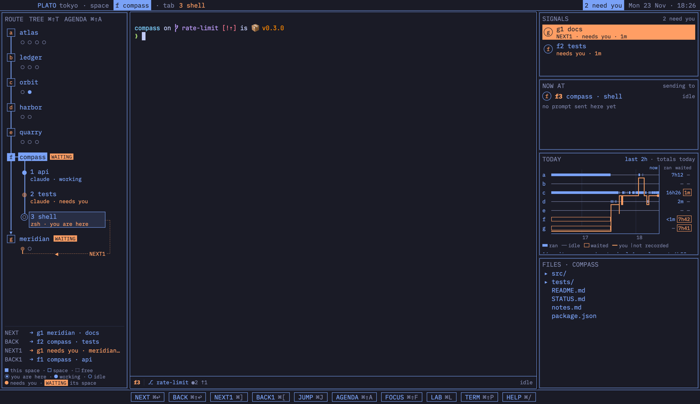
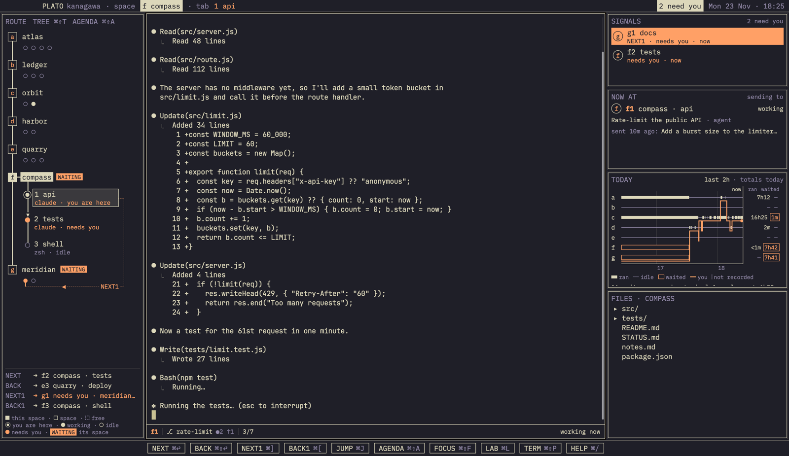
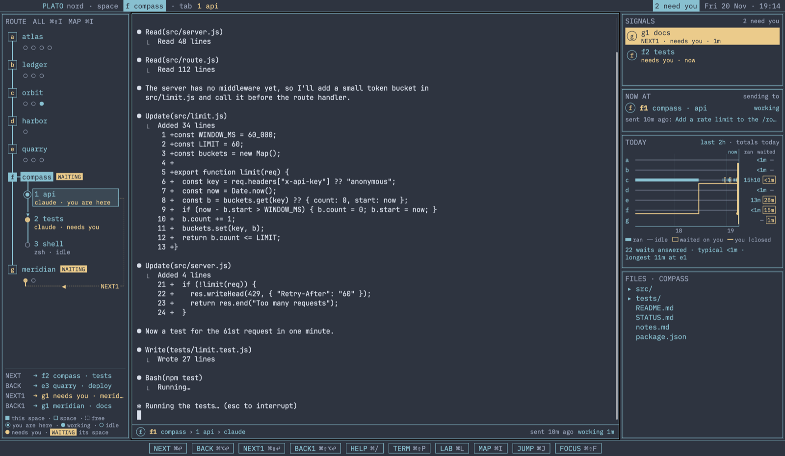
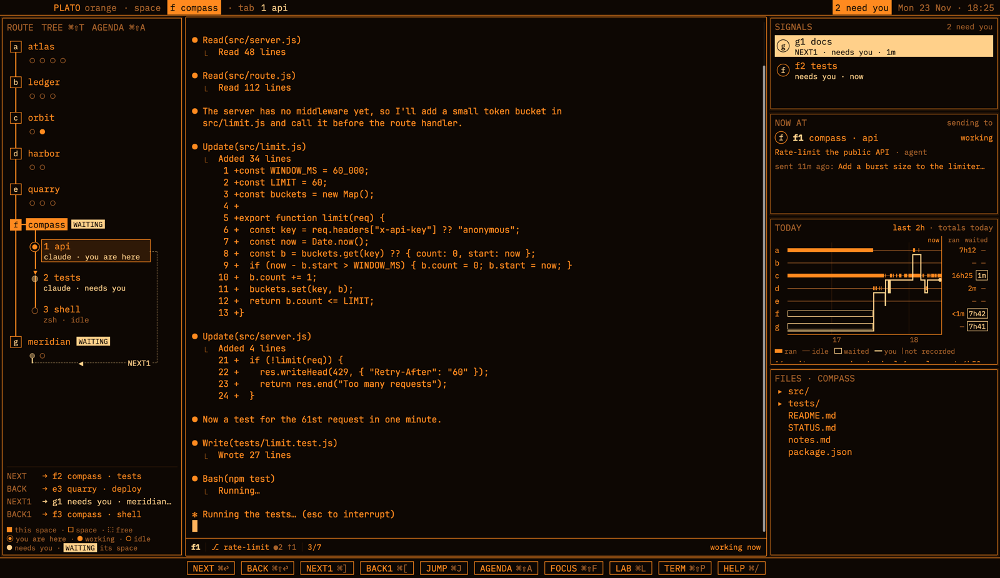
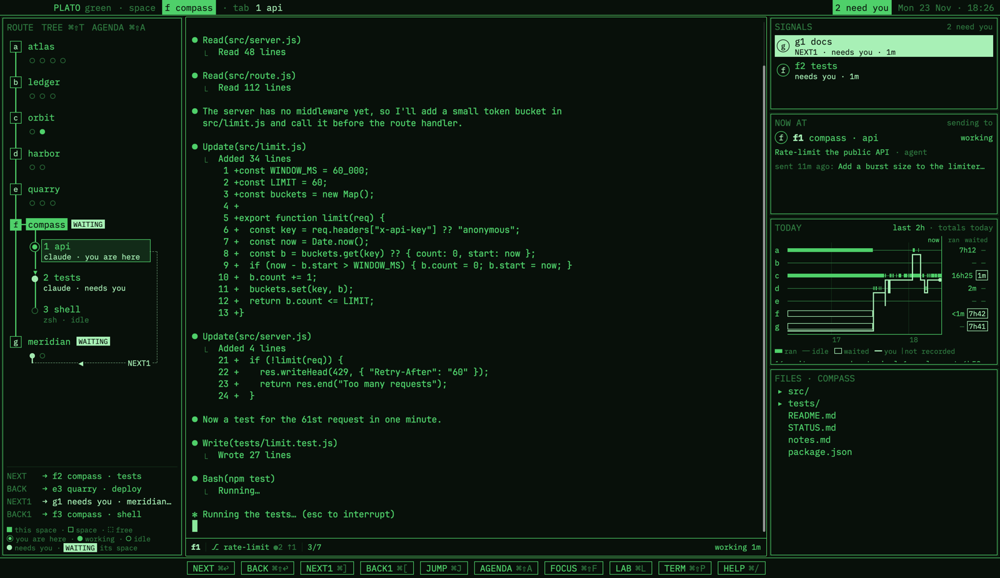
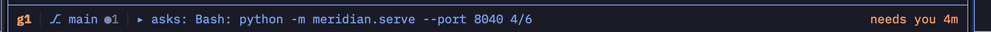
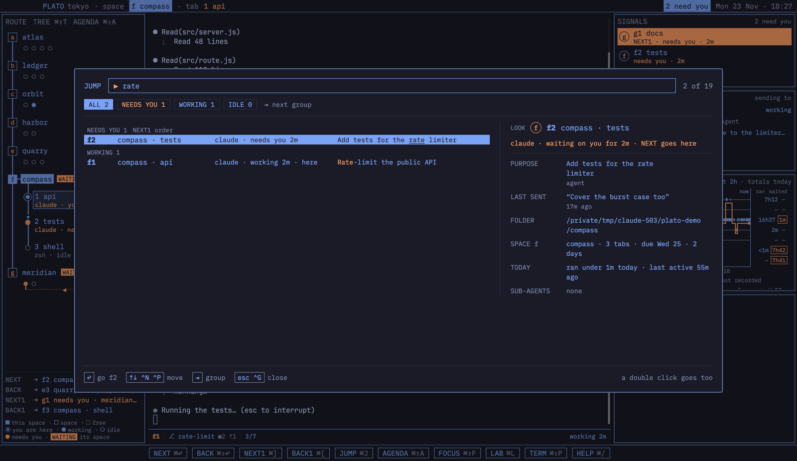
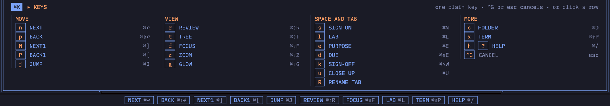

# PLATO for Herdr

PLATO is a layout for the [Herdr](https://herdr.dev) app. It helps you keep track of many terminals and coding agents at once. Every project gets a letter, and every tab gets a short code such as `c3`. One key takes you to the agent that waited longest for you.

The idea comes from the PLATO computer system of the 1970s and from Brian Dear's book "The Friendly Orange Glow". PLATO starts in Tokyo Night colors, with orange as the signal that an agent needs you, and it has [eight glows](#the-glows) in all.


## Quick start

You need the [Herdr](https://herdr.dev) desktop app on macOS. The install script also uses `python3` and `rsync`, which come with macOS.

1. Get PLATO and open a terminal in its folder:

   ```sh
   git clone https://github.com/arthurian/herdr-plato.git
   cd herdr-plato
   ```

2. Install PLATO and switch Herdr to it:

   ```sh
   ./install.sh
   herdr-app do layout.switch --name plato
   ```

3. Try these keys:
   - `cmd-n` (SIGN-ON): open a new space for a project. Type a name, and press `cmd-enter`. A folder is optional.
   - `cmd-enter` (NEXT): go to the next tab.
   - `cmd-]` (NEXT1): go to the agent that waited longest for you.
   - `cmd-shift-r` (REVIEW): read what each space got done today, or on the last day you worked.
   - `cmd-/` (HELP): see all the keys and words.

### Stop using PLATO

To go back to Herdr's default layout, run:

```sh
herdr-app do layout.switch --name main
```

Your spaces and tabs stay as they are. To come back, run the same command with `--name plato`. To remove PLATO completely, see [Uninstall](#uninstall).

## The idea in a minute

Herdr keeps your terminals in spaces and tabs. A space usually holds one project. A tab holds one terminal, or a few panes side by side. An agent is a coding assistant, such as Claude Code, that runs in a terminal.

PLATO adds a few ideas on top:

- Letters: each space gets a fixed letter, a, b, c and so on. A letter never changes by itself. When you close a space in the middle, its letter stays free, so the other spaces keep theirs.
- Codes: each tab has a code made of its space's letter and its number. `c3` is the third tab of space c. A tab split into panes adds the pane: `c3.2`.
- The line: the spaces in letter order. NEXT walks along it, tab by tab. You always know what comes next.
- Waiting: an agent that is blocked, or that finished and you have not looked yet, waits for you. PLATO marks it, counts it, and NEXT1 takes you there.
- Purpose: a short line that says what a tab is for, such as "Fix the login timeout in the API". You or the agent can set it.

## A tour of the screen

- The banner at the top says where you are, how many agents need you, and the time.
- The route on the left shows the line. The current space lists its tabs. Each other space shows one dot per tab, and a dot that waits for you pulses.
- The work area in the middle shows the current tab. A strip under each pane gives its code, its git branch, the agent's progress and its state. While an agent needs you, it also says what the agent waits to do.
- The right column has four panels. SIGNALS lists who needs you. NOW AT shows where your keys go now, the tab's purpose and your last prompt there. TODAY shows who waited on you today. FILES shows the project's folder tree.
- The keyset along the bottom shows the PLATO keys. A click on a key runs it.

PLATO works by mouse too. A click on anything that says an agent needs you takes you there. A right-click on a space or a tab opens a menu of its actions.

| Arrival after a jump | NEXT1 drawn on the route |
| --- | --- |
|  |  |
| Sign-on | Focus mode (`cmd-shift-f`) |
|  |  |
| LOOK (the Space bar) | |
|  | |

The spaces, tabs and agents in these pictures are made up for the demo.

## Everyday tasks

- Start work on a project: press `cmd-n`, type the project's name, and press `cmd-enter`. SIGN-ON shows the letter the space will take. You can add a folder, such as `~/dev/project`, and a due date, such as `fri` or `+5`. To set or change the due date later, press `cmd-shift-e` (DUE).
- Add a terminal or agent to the project: press `cmd-l` (LAB).
- See who needs you: look at SIGNALS, or press `cmd-]` (NEXT1) to go to the agent that waited longest.
- Go to a tab you know: press `cmd-j`, then type its code, such as `c3`, and press Enter.
- Read your day: press `cmd-shift-r` (REVIEW). For each tab that did something, it shows the latest result, the todo progress and the commits. Press ← for the day before.
- Look at an agent before you go there: press `cmd-shift-r`, pick its result with ↑ and ↓, and press the Space bar (LOOK). LOOK shows the purpose, the last prompt you sent and how long the agent worked or waited. Press Enter to go, or the Space bar to stay.
- Go back to where you were: press `cmd-[` (BACK1). Press it again to switch between your last two places.
- Concentrate on one tab: press `cmd-shift-f` (FOCUS). The right column hides. When an agent needs you, a SIGNAL line still tells you.
- Finish a project: press `cmd-alt-w` (SIGN-OFF). It shows a summary first, and only NEXT closes the space.
- Change the colors: press `cmd-shift-g` (GLOW), or click PLATO in the banner.

## Keys

| Key | Name | What it does |
| --- | --- | --- |
| `cmd-enter` | NEXT | Go to the next tab. On SIGN-ON or SIGN-OFF, confirm. |
| `cmd-shift-enter` | BACK | Go to the tab before this one on the line. On SIGN-ON or SIGN-OFF, cancel. |
| `cmd-]` | NEXT1 | Go to the agent that waits longest for you. |
| `cmd-[` | BACK1 | Return to where you were before. |
| `cmd-shift-r` | REVIEW | Open the review of your day, or close it. |
| `cmd-j` | JUMP | Find a tab by its code, name, purpose or folder, and go there. |
| `cmd-shift-t` | TREE | Show every space's tabs on the route, or only this one's. |
| `cmd-n` | SIGN-ON | Open a new space. |
| `cmd-alt-w` | SIGN-OFF | Close this space. |
| `cmd-u` | CLOSE UP | Remove the free letters and move the later spaces up, after a summary. |
| `cmd-l` | LAB | Add a tab (a terminal or agent) to this space. |
| `cmd-e` | PURPOSE | Set your purpose for this tab. |
| `cmd-shift-e` | DUE | Set or clear this space's due date. |
| `cmd-o` | FOLDER | Open this tab's folder in the file manager: Finder on macOS, Explorer on Windows, the desktop's default on Linux. |
| `cmd-shift-f` | FOCUS | Hide the right column and narrow the route, or bring them back. |
| `cmd-/` | HELP | Show the PLATO keys. |
| `cmd-k` | KEYS | Then one plain letter runs any PLATO command (see [the ⌘K panel](#the-k-panel-keys)). |
| `cmd-shift-p` | TERM | Open the command palette. |
| `cmd-shift-g` | GLOW | Step the glow. |
| `cmd-w` | CLOSE | Close an open PLATO dialog, else the tab. |
| `cmd-shift-z` | ZOOM | Zoom the pane (Herdr's `cmd-shift-enter` is BACK in this layout). |

The keys are in the `layout:plato` section of `keys.json`, so they apply only in this layout.

While LOOK, JUMP, HELP or a right-click menu is open, NEXT, BACK, NEXT1 and BACK1 wait, so a key never moves you behind a dialog. In SIGN-ON, SIGN-OFF, SET PURPOSE and SET DUE, NEXT confirms and BACK cancels.

If you come from Herdr: in PLATO, `cmd-]` and `cmd-[` are NEXT1 and BACK1. They work like Herdr's next and previous agent. But NEXT1 goes only to an agent that needs you, and BACK1 goes back to where you were. Herdr's pane zoom is `cmd-shift-z` in this layout.

## The glows

GLOW (`cmd-shift-g`) steps through eight glows, the four modern ones first.

| Tokyo Night (the default) | Kanagawa |
| --- | --- |
|  |  |
| Catppuccin Mocha | Nord |
|  |  |

### Classic glows

The four classic glows recreate the terminals of the 1970s and 80s. Orange is the color of the PLATO terminal itself.

| PLATO orange | Amber |
| --- | --- |
|  |  |
| Green | Paper white |
|  |  |

## Claude Code hooks

Three optional hooks let Claude Code tell PLATO what it is doing, and a skill lets it write the director's note for REVIEW:

- Your last prompt: NOW AT shows the last prompt you sent to each tab.
- The purpose: once your task is clear, Claude sets a short purpose for its tab. LOOK, the hover detail and NOW AT show it.
- The step: the strip under Claude's pane shows its progress, such as `3/7`. While Claude needs you, the strip also shows what it waits to do, such as `Bash: git push`.
- The director: type `/plato-director` in Claude Code to get a draft note for today, from the day's reports, comments, purposes and commits. Claude posts it to REVIEW only after you approve it. Add a day, such as `/plato-director 2026-11-23`, for an earlier day. Claude never starts the director by itself.

To turn them on, install `jq` (`brew install jq`) and run:

```sh
./install.sh --hooks
```

The script adds the hooks to `~/.claude/settings.json` and keeps a copy of the old file as `settings.json.before-plato`. It also lets Claude run `hc label` without a question, and outside Claude Code's sandbox, where `hc` cannot reach Herdr. It links the director skill as `~/.claude/skills/plato-director`. A skill of that name that is not PLATO's link stays as it is. Claude Code sessions that start after the install use the hooks and the skill. To remove them, run `./install.sh --hooks --remove`.

To set a purpose yourself, press `cmd-e` (PURPOSE). [For agents and scripts](#for-agents-and-scripts) tells how the purpose and the step work, and how another agent or a script can set them.

## Install in more detail

The install script copies the layout, the eight themes and the `plato` mod into Herdr's folder, `~/.config/herdr-app` (or `$HERDR_APP_HOME`). It also adds a `layout:plato` section to your `keys.json` and keeps a copy of the old file as `keys.json.before-plato`.

If PLATO is already installed, the script stops. Run `./install.sh --force` to replace it.

To upgrade, get the new version (`git pull` in the repo folder) and run `./install.sh --force`. TODAY's history stays, because it is kept outside the mod's folder. An install of v2.0.0 or earlier left seven other mods. If they are there, `--force` removes them: `plato-route`, `plato-strip`, `plato-sign`, `plato-nowat`, `plato-timetable`, `plato-banner` and `plato-signals`. The `plato` mod does their work.

PLATO keeps a record of each day in `~/.config/herdr-app/plato-data/YYYY-MM-DD.json`. It writes only after a change, and it deletes files older than 60 days.

## Uninstall

1. Switch Herdr to another layout, for example `herdr-app do layout.switch --name main` (see [Stop using PLATO](#stop-using-plato)).
2. If you turned on the Claude Code hooks, remove them with `./install.sh --hooks --remove`.
3. Remove PLATO's files from Herdr's folder:

   ```sh
   H="${HERDR_APP_HOME:-$HOME/.config/herdr-app}"
   rm -r "$H/mods/plato" "$H/layouts/plato.json" "$H/layouts/plato.svg" "$H"/themes/plato*.json
   ```

4. In the same terminal, remove PLATO's keys from `keys.json`. This keeps any other keys that you changed after the install:

   ```sh
   python3 -c 'import json,sys; p=sys.argv[1]; k=json.load(open(p)); k.pop("layout:plato",None); json.dump(k,open(p,"w"),indent=2)' "$H/keys.json"
   ```

5. To also delete TODAY's history, remove `$H/plato-data`.

To get your earlier `keys.json` back instead, use the copy that the install kept, `keys.json.before-plato`.

## Each panel in detail

### The route

The route is the line of spaces on the left. Each space is a square with its letter inside. Under the current space you see its tabs, each with a round lamp, its program and its state. A ring around a lamp marks the tab you are at. Under the other spaces you see one dot per tab:

- A filled dot is an agent that works or waits for you. A hollow dot is idle.
- A dot that waits for you pulses, and its space has a WAITING tag in reverse video.

A click on a space, a dot or a tab goes there. A click on a WAITING tag goes to the agent that waits in that space. Put the pointer on a dot, a tab's lamp or row, or a one-line row in TREE, and the readout at the bottom shows that tab. It shows the code and names, the purpose with its source, and the state with its time. When the pointer leaves, the readout comes back.

A right-click on a space's square or name opens its menu: RENAME (`shift-F2`), LAB (`cmd-l`), SET DUE (`cmd-shift-e`) and SIGN-OFF (`cmd-alt-w`). A free letter offers SIGN-ON there instead. CLOSE UP (`cmd-u`) shows while the line has free letters. A right-click on a tab or a dot opens the tab's menu: GO (Enter), LOOK, RENAME TAB (`F2`), SET PURPOSE (`cmd-e`) and FOLDER (`cmd-o`). Each item does what its key does, and SIGN-OFF still shows its summary first. A small ▼ on the line points the way NEXT goes. NEXT1's way is drawn as a dashed line from your tab to its target, with the word NEXT1 on the target's row. The readout at the bottom names the targets of NEXT, BACK, NEXT1 and BACK1.

TREE (`cmd-shift-t`) shows every space's tabs instead of dots, one line each, with the code, the program and the state. Press it again to go back. The route's title shows TREE in reverse video while it is on. A click on "TREE ⌘⇧T" or "REVIEW ⌘⇧R" in the title does the same as the key.

### Moving

- NEXT goes to the next tab on the line. After the last tab it wraps to space a.
- BACK goes to the tab before, and before the first tab it wraps to the last.
- NEXT1 goes to the agent that waited longest. Blocked agents come first, then agents that are done but not seen.
- BACK1 returns to where you were before, however you got there.

After every move, the banner says "ARRIVED AT f1 meridian · docs from e2". The strip turns to reverse video and says "arrived from e2". Both go away after 4 seconds, or as soon as you send a prompt there.

### The strip and the banner

The strip is a line under every pane. It describes its own pane, wherever your keys are, so each pane of a split tab has its own. From left to right it shows:

- The tab code, such as `d2`, or `c1.2` in a split tab.
- The git state of the pane's folder: the branch, then `●3` changed files, `↑2` commits to push and `↓1` to pull. A count of zero does not show. A folder outside git shows no git part.
- The agent's progress, such as `3/7`. While the agent needs you, the strip also shows the step it waits to run, such as `▸ asks: Bash: git push`. While the agent works, the step does not show, so the strip stays still.
- The state with its time, such as `working 12m`.



The banner and NOW AT show the space, the tab and the purpose, so the strip leaves them out. When the pane is narrow, the step is cut first, then the branch. PLATO reads the git state every 10 seconds, and at once after you change folder or branch.

The banner says "PLATO · space e compass · tab 1 api" on the left. On the right it shows how many other agents need you, the date and the clock. A click on "2 need you" does what NEXT1 does. After PLATO it names the current glow in dim text, for example "PLATO amber". The name is bright for two seconds after a change. A click on PLATO steps the glow, and its tooltip names the key, `cmd-shift-g`.

### SIGN-ON, SIGN-OFF and CLOSE UP

SIGN-ON (`cmd-n`) opens a new space. Type a name, then press NEXT. SIGN-ON shows the letter the space takes, which is the first free letter. → puts the space at the end of the line instead. The folder is optional. Type it as `~/…`, `/…` or a path in your home folder. Or click "choose…" or press `cmd-o`, and pick it in the system folder picker. PLATO does not look for a folder on its own. With no folder, the space starts in your home folder. The due date is also optional (`fri`, `27`, `11/27`, `+5`). Tab, ↓ and ↑ move between the fields.

SET DUE (`cmd-shift-e`) sets or changes the due date of the space you are in. A right-click on a space offers it too. Type the date in the same forms as in SIGN-ON, and the line under it shows the day it means. Enter saves, and a blank line clears the date. Esc cancels.

SIGN-OFF (`cmd-alt-w`) closes the current space. It shows a summary first: the time open, the tabs, the due date, and what happens to the line. Only NEXT closes the space. NEXT1 also closes it and goes to the agent that waits for you. BACK keeps it open. A space in the middle leaves a free letter, so the other spaces keep theirs. On SIGN-OFF, `U` closes up the line instead and gives the later spaces new letters.

CLOSE UP (`cmd-u`) closes up the line at any time. It lists the free letters and the moves first, and only NEXT closes up the line. Free letters at the end of the line are removed.

On SIGN-ON, SIGN-OFF and CLOSE UP, the keys at the bottom are boxed. A click on a box does what the key does. So you can also answer a page by mouse, for example one you opened from a menu.

### The right column

SIGNALS lists the agents that need you, in NEXT1 order, with how long each waited. The first row, in reverse video, is where NEXT1 goes. A click on a row goes to that agent. A right-click opens the tab's menu. Its LOOK shows the agent's details, and the arrow keys then step through the waiting agents in NEXT1 order.

NOW AT shows where your keys go now: the tab code, space, tab and state. Below that it shows the last prompt you sent there. If the tab has a purpose, NOW AT shows it in full between the two. After a jump it says "changed".

TODAY shows who waited on you today, and for how long:

- The graph shows the last two hours that the app was open, with one row per space letter. A click on "last 2h" steps it to 6, 12 or 24 hours. A long window also shows part of yesterday.
- A bar shows where an agent ran, a thin line shows idle time, and a hollow box shows where an agent waited for you. A bright line shows the path you took between spaces. A short gap with a dim line shows time with no record, because Herdr was closed or another layout was shown. The key calls it "not recorded".
- At the right end of each row are today's totals: how long the space ran, and how long it waited for you.
- The response line says how many waits you answered today, with the typical wait and the longest. An example is "6 waits answered · typical 3m · longest 21m at d2".
- If a space has a due date, the due list shows it.

A click on a row's letter or totals goes to that space, and a click on a wait box goes to the tab that waited. PLATO records the day while the PLATO layout is shown, in every view: with REVIEW open and in FOCUS too. TODAY, REVIEW, LOOK and JUMP read the record.

While REVIEW is open, DUE and RUNNING take the place of TODAY and FILES. DUE lists the spaces with a due date, soonest first. RUNNING lists the agents that work now, longest first, each with your purpose, how long it has run and its progress, such as `3/7`. Its last line counts the idle agents. Both always show now, whatever day REVIEW shows.

FILES shows the folder tree of the project you are in, which is the git root of the focused terminal's folder. A click on a folder opens it. A click on a file shows it in a viewer pane.

### REVIEW

REVIEW (`cmd-shift-r`) is THE PLATO REVIEW, the review of your day. It covers the route and the terminal, and it answers one question: what did each space get done? Press `cmd-shift-r` again, Esc or `ctrl-g` to close it. `cmd-k r` opens it too.

REVIEW opens on today so far, from midnight local time. Press ← for an earlier day.

REVIEW has two pages, DAY and COMMENTS. It opens on DAY. The title line names the day and the two pages. The name COMMENTS shows how many comments the day has, for example `COMMENTS 4`.

Keys in REVIEW:

- Tab and shift-Tab switch between DAY and COMMENTS. A click on a page name does the same.
- ↑ and ↓ pick a result on DAY. On COMMENTS, they pick the director's note, which comes first, or a comment.
- The Space bar opens LOOK for the picked tab (see below).
- Enter goes to the picked tab.
- ← and → show the day before or after. PLATO keeps 60 days.
- `c` copies what is picked. A result copies with its tab code, purpose, time and report, a comment with its tab and time, and the note in full.
- `t` hides TIMELINE on DAY, so RESULTS and the facts take its height, and shows it again. A click on the TIMELINE line does the same. REVIEW keeps your choice until Herdr quits.
- `cmd-j` opens JUMP over REVIEW.
- Esc, `ctrl-g` or `cmd-shift-r` closes REVIEW. Any move closes it first.

The key line under the page shows these keys, and a click on a key does what the key does. SIGN-OFF, LAB, PURPOSE and DUE act on the tab you are at, not on the pick.

#### DAY

The DIRECTOR line comes first. It shows the first sentence of the day's note on one line. Without a note, it reads `no note today`. A click on the line, or Tab, shows the whole note on COMMENTS.

RESULTS lists every result of the day, one row each, grouped by space in the route's order. Each group starts with the space's letter in a box, as on the route, its name and its count of results, and its rows are newest first. A tab with three results has three rows. The picked row looks like this:

```
  [a] atlas                                   3 results
▶ 16:05 a1 fixed burst overflow
  Rate-limit the public API
  todo 6/6 · 2 commits   ◷ here 2h12 · waited 29m
  report · 16:06
  ✎ Limits now apply per key. Load test passes at 2x traffic.
```

Each row has the time of the result, the tab's code and the result. ✕ marks a task that was dropped. The picked row, marked ▶, also shows the tab's purpose, the todo progress, the commits, your time at the tab and the report that the agent posted with that result. A result older than the tab's purpose adds `before this purpose`. When rows are below the visible part of RESULTS, a dim line at its bottom right counts them, such as `3 more ↓`.

Next to RESULTS:

- DONE counts the day's results by verb, with a bar for each, such as `fixed 4` and `shipped 2`.
- OPEN lists the tabs whose purpose has no result yet, with the age of the purpose. A tab with commits but no purpose shows as `(no purpose)`.
- HOW IT WENT shows your sessions, your tab switches per hour, how long agents waited on you, and how many questions they asked.

TIMELINE, at the bottom, has one row for each space across the day. A shaded bar shows where you were, and the number in it is the tab. A thin line shows where an agent worked, and an orange mark shows where an agent waited on you. ✓ marks each result, and `✓2` means two results close together. A hatched strip above the rows marks quick switching between tabs, with a count such as `×14`. On today's page, a bright line marks now.

TIMELINE follows your pick in RESULTS. The picked tab's bars have a box around them, and the other bars dim. A click on a bar picks the newest result of its tab.

![REVIEW's DAY page for Wed 18 Nov, with COMMENTS 4 in the title line. Under it, the DIRECTOR line gives the note's first sentence: most of the day went to small fixes, and the migration plan waited two hours. RESULTS groups the results by space: a atlas with 3 results, b ledger and c orbit with 1 each, and the heading of d harbor show, each letter in a box. The picked row, a1 at 16:05 "fixed burst overflow", also shows its purpose "Rate-limit the public API", todo 6/6, 2h12 here, and its report from 16:06. a has three rows, from a1 and a3, and c1 shows ✕ dropped shared cache layer. "3 more ↓" at the bottom right counts the rows below. On the right, DONE has a bar for each verb, OPEN lists d2, and HOW IT WENT gives the sessions, switches, longest hold and waits. TIMELINE fills the lower half with rows a to g, and a1's bars have a box around them.](previews/review.png)

#### COMMENTS

COMMENTS starts with the DIRECTOR'S NOTE, the day's note in full. It is the first pick, so `c` copies it when COMMENTS opens. Without a note, this part is one dim line. Under it, COMMENTS lists every comment of the day, newest first, with its tab and its time. A comment is an agent's observation about how you work with it.


#### Where the numbers come from

Code counts every number from the day record, the tab labels and `git log`. No model writes or estimates a number. PLATO never keeps your prompts. Only a commit by the repository's own `user.email` counts.

A badge in the title line says what REVIEW knows. `FACTS ONLY` means that no agent posted that day. `FACTS + 9 POSTS` means that agents posted nine pieces. If a source is missing, a line under the title names it, because a missing source never shows as zero. A day with no record says so and gives the reason, for example "PLATO was not running".

A past day shows that day's own values. REVIEW reads the record only while it is open.

To fill REVIEW with reports, comments and a note, agents use `plato-post` (see [For agents and scripts](#for-agents-and-scripts)). In Claude Code, `/plato-director` writes the note. REVIEW works without them.

### LOOK

LOOK shows a tab's details before you go there. Press the Space bar in REVIEW, or right-click a tab on the route or a SIGNALS row and choose LOOK. The card shows the code, space and tab, the program, the state with its time, and whether NEXT or NEXT1 goes there. Under that are the purpose in full with where it came from, the first prompt when it is different, the last prompt you sent and when, the folder, the space's tabs and due date, today's run time, and running sub-agents.

In LOOK, Enter goes to the tab. The arrow keys show the next card: along the line, or from SIGNALS through the waiting agents in NEXT1 order. The Space bar or Esc closes LOOK. `cmd-e` closes it and sets that tab's purpose.

### JUMP, FOCUS, HELP and the keyset

JUMP (`cmd-j`) finds a tab and goes there. It opens a dialog that lists every tab. The agents that need you come first, in NEXT1 order, then the working agents, then the idle tabs in line order. Type part of a tab's name, space, purpose or folder to narrow the list. Each word must match, in any order, and the matched letters light up. A code such as `c3`, or a space's letter, puts that tab first, so a code and Enter go there at once. Beside the list is the selected tab's LOOK card. The arrows, or `ctrl-n` and `ctrl-p`, move. Tab shows one group at a time. Enter or a double click goes to the tab. Esc, `ctrl-g` or `cmd-j` again closes JUMP. In REVIEW, JUMP opens over the page, and closing it puts you back in REVIEW.



FOCUS (`cmd-shift-f`) hides the right column and narrows the route to a column of lettered squares. The current space is filled. A space with an agent that waits for you pulses and has a WAIT tag. If an agent in another tab needs you, a flashing SIGNAL line shows above the keys. A click on the line does what NEXT1 does, and a click on a WAIT tag goes to the agent in that space. Press FOCUS again to bring the columns back. NEXT, BACK, NEXT1 and REVIEW keep working.

HELP (`cmd-/`) has two screens. KEYS lists every PLATO key and one line about the mouse, Herdr's own picker (`cmd-p`) and its command palette (TERM, `cmd-shift-p`). It also lists the rename keys: `shift-F2` for a space, which keeps its letter, and `F2` for a tab. WORDS explains the letter, the code, the free letter, WAITING, the route's marks, SIGNAL, REVIEW, JUMP and the purpose. → or Enter shows the next screen, ← the one before, and 1 or 2 goes straight there.

The keyset along the bottom shows NEXT, BACK, NEXT1, BACK1, JUMP, REVIEW, FOCUS, LAB, TERM and HELP as boxed keys, each with its shortcut: the moves, then the views, then the rest. The route's title also shows the TREE and REVIEW keys.

### The ⌘K panel (KEYS)

KEYS gives every PLATO command a short, plain letter after `cmd-k`. Press `cmd-k`, release it, then press one letter. For example, `cmd-k d` sets the due date, and `cmd-k j` opens JUMP. If you press the letter within half a second, nothing shows. If you pause, a panel at the bottom of the window lists the letters in four groups: MOVE, VIEW, SPACE AND TAB, and MORE. Each row shows the letter, the command and its direct key. A click on a row runs it.

The letters are easy to remember: `n` NEXT, `p` BACK, `r` REVIEW, `d` DUE, `k` SIGN-OFF, `x` TERM and `h` HELP. Capital `N` is NEXT1 and capital `P` is BACK1. HELP also takes `?`. `z` is ZOOM and capital `R` is RENAME TAB. The panel takes plain letters only. A key typed with `cmd` held is never a panel key. `ctrl-g` or Esc closes the panel, and nothing runs. A letter with no command also closes it, and the banner says "⌘K q is undefined" for two seconds.



## For agents and scripts

PLATO reads a few labels on each terminal. The Claude Code hooks set them for Claude, and any other agent, wrapper or script can set them with `hc label`.

### The purpose

A tab can have three kinds of purpose, and the first one that is set wins:

1. Yours: press `cmd-e` (PURPOSE), or right-click a tab and pick SET PURPOSE, then type it and press Enter. Leave it blank to remove it. In a script, use `hc label <terminal> "plato.purpose_yours=Ship the v2 API" "plato.purpose_at=$(date +%s)"`, and `hc label <terminal> plato.purpose_yours=` to remove it. REVIEW uses `plato.purpose_at` to show the purpose's age in OPEN.
2. The agent's: when the goal changes, the agent sets a new purpose, and the card says `· agent, revised`.
3. The session's first prompt, until one of the others is set.

LOOK, the hover detail and NOW AT show where a purpose came from in dim text: `· yours`, `· agent`, `· agent, revised` or `· first prompt`. When you arrive at a tab, its strip reads `GOAL <purpose>`.

### The last prompt

NOW AT shows `plato.last`, the last prompt you sent to a tab, and `plato.last_at`, when you sent it, in unix seconds. To try NOW AT without the hooks, set them by hand:

```sh
hc label <terminal> "plato.last=fix the login bug" "plato.last_at=$(date +%s)"
```

### Step labels

The strip shows an agent's step from three labels on its terminal. PLATO does not know which agent writes them:

| Label | What it holds | Example |
| --- | --- | --- |
| `plato.step` | What the agent does now, in its own words. The strip shows it while the agent needs you, on one line, cut at 60 characters. | `Bash: git push` |
| `plato.step_at` | When the step started, in unix seconds. | `1795474442` |
| `plato.tasks` | The agent's progress, as short text. An empty value clears it. | `3/7` |

Set `plato.step_at` with each step. A step older than `plato.last_at`, the time of your last prompt, does not show, because it belongs to an earlier turn. For example:

```sh
hc label <terminal> "plato.step=reading the diff" "plato.step_at=$(date +%s)"
```

### Session and result labels

REVIEW counts sessions and results from four more labels on a terminal. The Claude Code hooks set them, and any other agent can write them.

| Label | What it holds | Example |
| --- | --- | --- |
| `plato.session` | The id of the agent's session. Each different value on a terminal is one session. | `7f3c9a1e` |
| `plato.session_how` | How the session began: `startup`, `resume`, `clear` or `compact`. | `resume` |
| `plato.done` | The latest result, in five words or fewer. The first word is a past-tense verb: researched, explored, explained, brainstormed, designed, planned, decided, built, fixed, refactored, configured, tested, diagnosed, reviewed, shipped, documented, drafted or dropped. Another verb counts as "other". | `fixed login timeout` |
| `plato.done_at` | When the result was set, in unix seconds. Each different value is one result, so the same words twice count twice. | `1795474442` |

The agent sets a result only at a milestone, because REVIEW counts each result. A milestone is a point that you would want to see in a summary of the day. The hook gives examples: a finished phase or plan step, a pull request opened or merged, a deploy or another change outside the repo, a ticket that changes status, a research question answered with a finding, a decision, a document drafted or finished, or a goal that you call done. For other work, the agent uses its judgment. Small steps toward the same milestone set none. For example:

```sh
hc label <terminal> "plato.done=fixed login timeout" "plato.done_at=$(date +%s)"
```

### Posting to REVIEW

`plato-post` sends one piece to REVIEW. It is a shell script. `./install.sh --hooks` links it as `~/.local/bin/plato-post`.

```sh
plato-post report "Stopped at test_backfill_order. Steps 6 to 8 wait on it."
plato-post comment "You changed the goal twice in this session. Each change undid an hour of work. Writing the goal down first would help."
echo "Monday was a finishing day. ..." | plato-post note
plato-post --help
```

There are three kinds:

| Kind | What it holds | Limit |
| --- | --- | --- |
| `report` | Facts about the sender's own work. | 280 characters |
| `comment` | An agent's observation about how you work with it. | 400 characters |
| `note` | The director's note, the one piece you can pass on as it is. | 1500 characters |

If the text is longer than its limit, `plato-post` refuses it with a message and does not cut it. Without text on the command line, it reads standard input. It reads `HC_TERMINAL_ID` to name the sender's terminal. Without it, the post shows "no tab". The option `--day YYYY-MM-DD` files a post for another day, so a director that runs early can write about yesterday.

Each post is one file, `plato-data/posts/YYYY-MM-DD/<unix seconds>-<terminal or none>-<kind>.md`, in PLATO's data folder (`~/.config/herdr-app` unless `HERDR_APP_HOME` says otherwise). It has three header lines (`kind`, `terminal` and `time`), an empty line and the text. `plato-post` prints the path, or an error and a non-zero exit. PLATO deletes post folders with the day files after 60 days. REVIEW shows the latest report of each tab, every comment of the day and the latest note. The other posts stay in the folder.

The posting rules, which the Claude Code hook gives each session:

- A report: each time the agent sets `plato.done`, at a milestone, it sends one report of one or two sentences with the facts behind the result.
- A comment: comments are about how you and the agent work together, not about the work. When an agent sees friction repeat in one session, or a habit that clearly saved time, it writes a comment. Examples are the same approval again and again, the same correction repeated or a file or status it had to search for each time. A comment starts with "You" or "Your", gives one fact, and ends with one lasting change that would remove the friction: a permission rule, a line in CLAUDE.md or AGENTS.md, a skill, a script, or a change in how files, handoffs or status files are organized. If the agent cannot name such a change, it writes no comment. Exploring in conversation is a way of working, so a comment never asks for more detail at the start. A comment is about what you did, never about who you are. It is honest, even when it is unflattering, and never praise for its own sake. The state of the work, risks and advice about PLATO go in the agent's reply and its report. Most sessions end with no comment. A terminal sends at most one comment an hour, and `plato-post` refuses a sooner one or one that does not start with "You" or "Your".
- A note: only an agent that you start as the director writes one, for example with `/plato-director`. Other agents never do.
- You can always ask an agent to post, for example "post a report about the timezone choice". The one-hour limit and the rules for comments still apply.

For an agent other than Claude Code, add these rules to its global instructions by hand. PLATO does not edit those files.

### What `--hooks` adds to the settings

`./install.sh --hooks` adds the permission rule `Bash(hc label:*)`, so Claude sets its purpose without a question. It also adds the sandbox exclusion `hc label:*`, which runs `hc label` outside the sandbox. If `hc label` runs alone, with no pipe or redirect, the exclusion applies. It adds the same two entries for `plato-post`: the permission rule `Bash(plato-post:*)` and the sandbox exclusion `plato-post:*`. It links two files outside the settings: `~/.local/bin/plato-post` and the director skill, `~/.claude/skills/plato-director`. A second run of the script adds nothing.

## Work on PLATO

To change the code, read [DEVELOPING.md](DEVELOPING.md). `RECIPE.md` is the brief from which an agent can build PLATO from scratch.

## License

The code is under the MIT License (`LICENSE`). The bundled IBM Plex Mono fonts keep their own SIL Open Font License, in `mods/plato/fonts/OFL-IBMPlexMono.txt`.

## References

- [PLATO Codex](https://codex.retro1.org/plato:start): a reference on the PLATO system.
- Brian Dear, "The Friendly Orange Glow: The Untold Story of the PLATO System and the Dawn of Cyberculture" (Pantheon, 2017).
- [Nord](https://www.nordtheme.com) by Arctic Ice Studio and Sven Greb, under the MIT License: the colors of the nord glow.
- [Catppuccin](https://catppuccin.com), under the MIT License: the colors of the mocha glow, from its Mocha flavor.
- [Tokyo Night](https://github.com/folke/tokyonight.nvim) by Folke Lemaitre, under the Apache License 2.0: the colors of the tokyo glow, from its Night style.
- [Kanagawa](https://github.com/rebelot/kanagawa.nvim) by Tommaso Laurenzi, under the MIT License: the colors of the kanagawa glow, from its Wave theme.
