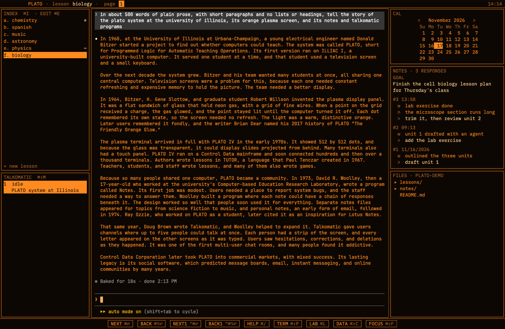
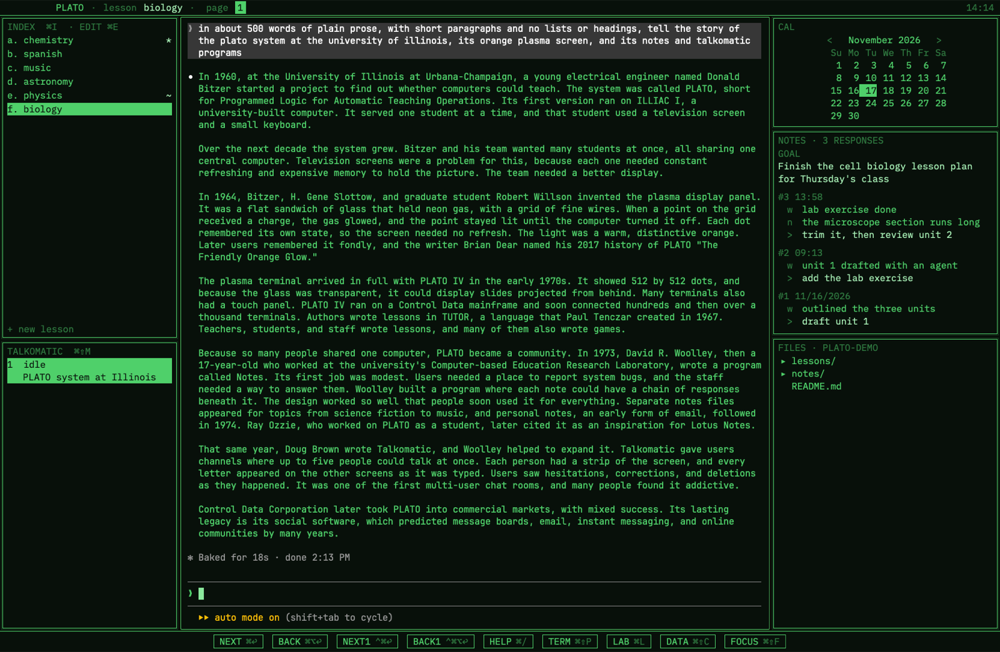
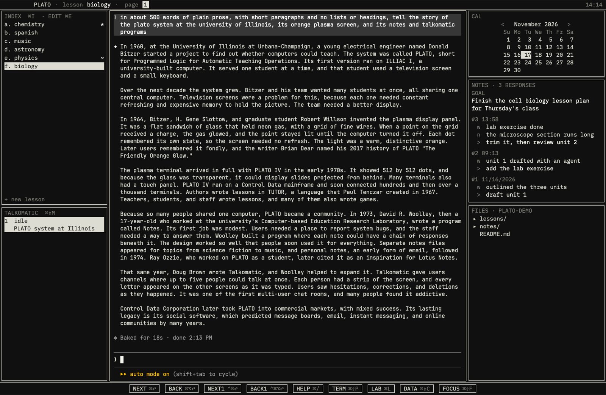

# PLATO for Herdr

A layout, four themes and a mod for the [Herdr](https://herdr.dev) app, inspired by the PLATO system and Brian Dear's book "The Friendly Orange Glow". The window glows orange on a warm black, or in amber, green or white like other classic terminals. You move between projects with a PLATO index page and between terminals with PLATO keys.

| PLATO orange (the default) | Amber |
| --- | --- |
|  |  |
| Green | Paper white |
|  |  |

## What you get

- INDEX: your spaces as a lettered lesson list. Press `cmd-i` (shown in the panel title), then a letter.
- EDIT (`cmd-e`): rename the current lesson in place. While choosing in INDEX, EDIT then a letter renames that lesson; in MONITOR, EDIT then a row number names that row's tab. EDIT TAB (`cmd-shift-e`) renames the tab you are in. An empty name restores the automatic one.
- TALKOMATIC: every shell and agent in the current space, with each agent's status. Press `cmd-shift-m` (shown in the panel title) and a row number, or click "monitor" on a row, to look at that terminal without leaving yours. `cmd-shift-m` again, `cmd-w` or the CLOSE button closes the view, and GO TO THIS AGENT (or SHELL), or NEXT (`cmd-enter`), switches to it. While it is open, keys, Esc too, go to that terminal.
- CAL: the current month, like Unix `cal`. A click opens three months side by side, like `cal -3`.
- NOTES: the lesson's notesfile, in the shape of PLATO Notes: a GOAL on top, and numbered checkpoint responses below (w worked, n noticed, > next). A click opens the full notesfile in a dialog.
- FILES: the project's folder tree. A click opens a file in a viewer pane.
- The keyset: NEXT, BACK, NEXT1, BACK1, HELP, TERM, LAB, DATA and FOCUS. Press `cmd-/` for the full list.
- FOCUS (`cmd-shift-f`): hides both side columns so the terminal fills the window. `cmd-i` then opens INDEX as a dialog. If another agent needs you, a flashing PAGE line appears above the keys.
- CLOSE (`cmd-w`): in the PLATO layout, closes an open PLATO dialog or MONITOR view, and only otherwise closes the tab.
- HELP (`cmd-/`) shows the keys for where you are: the classroom, focus mode, INDEX, MONITOR or DATA.
- A lesson about PLATO: press `L` in HELP. Eight short pages, with NEXT (Enter or →) and BACK (←), each naming its source.

## Install

The install script copies the layout, the themes and the mod into Herdr's folder (`~/.config/herdr-app`, or `$HERDR_APP_HOME`). It also adds a `layout:plato` section to your `keys.json` and keeps a copy of the old file as `keys.json.before-plato`.

```sh
./install.sh
herdr-app do layout.switch --name plato
```

If PLATO is already installed, the script stops. Run `./install.sh --force` to replace it.

## Work on it

Herdr reloads a changed mod file at once, but it does not follow a symlink for this. So you edit the live files in `~/.config/herdr-app`, and you copy them into this repo before a commit:

```sh
./sync.sh
git status
```

Run the logic tests with Node:

```sh
cd mods/plato && node --test test/*.test.mjs
```

Check the mod with Herdr:

```sh
herdr-app check ~/.config/herdr-app/mods/plato
```

## Settings

- DATA (`cmd-shift-c`) opens a checkpoint: GOAL, WORKED, NOTICED and NEXT, with Tab between them. It saves to NOTES, inside Herdr. The last line, FILE, starts empty. If you type a file path there, for example `~/Documents/herdr-plato-notes.md`, each save also appends a Markdown copy to that file. DATA remembers the path.
- Press `cmd-shift-g`, or click PLATO in the banner, to step the glow: orange, amber, green, then white.

## License

The code is under the MIT License (`LICENSE`). The bundled IBM Plex Mono fonts keep their own SIL Open Font License, in `mods/plato/fonts/OFL-IBMPlexMono.txt`.

## References

- [PLATO Codex](https://codex.retro1.org/plato:start): a reference on the PLATO system.
- Brian Dear, "The Friendly Orange Glow: The Untold Story of the PLATO System and the Dawn of Cyberculture" (Pantheon, 2017).
