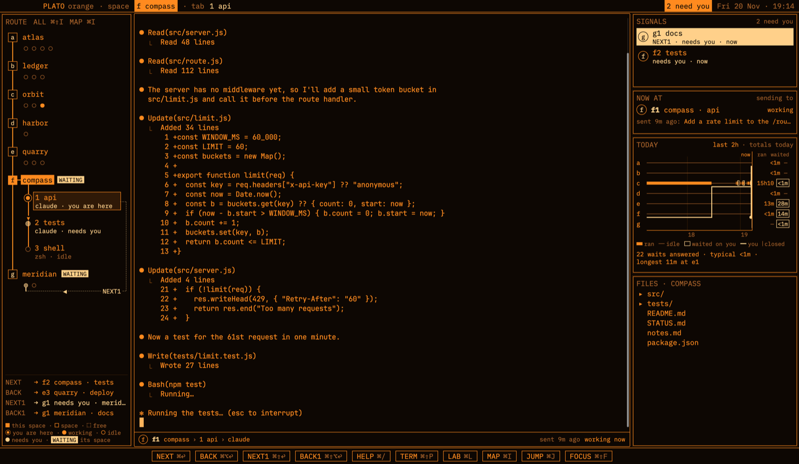

# PLATO

A Herdr layout in the style of a PLATO terminal, with your spaces drawn as a line. The text is orange on near-black, or amber, green or paper white, or frost blue on Nord's dark gray, or mauve on Catppuccin Mocha's base. Panels are boxed and use IBM Plex Mono. Each space has a fixed letter, and each tab has a code such as `c3`. The route of spaces is on the left, the terminal is in the middle, and SIGNALS, NOW AT, TODAY and FILES are on the right. A row of PLATO keys runs along the bottom. MAP shows every space as a column of tab cards.

## What you see

- Banner (28 px, top): `PLATO · space e compass · tab 1 api` on the left. The space is in reverse video. PLATO is followed by the glow's name in dim text (`PLATO amber`, `glowWord` in `glow.js`); the name is bright for two seconds after a change. A click on either steps the glow. On the right: the date and the clock. When agents need you (blocked, or done and not seen), "N needs you" shows before them in reverse video. The count leaves out the tab you are at, so it agrees with NEXT1. For 4 seconds after a move, the left side is `▶ ARRIVED AT f1 meridian · docs from e2 compass` in reverse video instead, so the arrival never covers the terminal. A click on PLATO steps the glow.
- ROUTE (260 px, left, at least 48 px):
  - One row per letter in `plato.line`. A space is an 18 px square on the line with its letter inside, like a key cap, and its name beside it. The current space's square is filled, with the letter in reverse video, and its name is in reverse video too. A space with an agent that needs you has a reverse-video WAITING tag right after its name, a mark that shows without motion or color. A free letter is a dashed square with a dim letter and "free since 14:02".
  - Under the current space, a branch with one row per tab: the number and label, then `program · state`. Each tab has a round lamp, filled when working or waiting. The current tab's lamp has a ring around it, and its text is boxed and says "you are here", or "◀ arrived from e1" during an arrival.
  - Under the other spaces, one dot per tab. A working or blocked dot is filled. An idle or done dot is hollow. A blocked dot pulses.
  - NEXT1 as a dashed bright run: out from the current tab and down the right edge, then in on a line under the target's row (a dot row, a one-line row in ALL, or a two-line tab row) and up into its dot or lamp. It never crosses another dot or any tab's text, and the target keeps its full width. A ◀ halfway along that line shows the direction, and the word NEXT1 sits on it, at its right end.
  - NEXT as a small ▼ at the end of the line into its target, its tip on the target's marker: on the branch for a tab of this space, or on the line for the next space's square. When NEXT wraps back to a, no ▼ shows.
  - A readout at the bottom, four lines in the order of the keys: `NEXT → e2 compass · tests`, `BACK → c2 orbit · shell`, `NEXT1 → f1 needs you · meridian · docs` (or "nothing waiting"; the code and reason come first, so a cut keeps them), `BACK1 → c1 orbit · build`. A three-line legend under it, drawn with the route's own marks: ■ this space, □ space, a dashed □ free; the ringed lamp for you are here, ● working, ○ idle; a bright ● for needs you, and the WAITING tag for its space.
- Work area: the active tab, `lone: true`, panes with a 1 px border and an accent border on the focused pane.
  - The strip (28 px, bottom header of every pane): the space's letter in a circle, the tab code, `space › tab › program`, "sent 12m ago", and the state with its time. After an arrival it is in reverse video with "◀ arrived from e1".
- Right column (280 px, at least 200 px):
  - SIGNALS (150 px, room for three rows, always shown): the agents that need you in NEXT1 order, without the one you are at. Each row has the letter in a circle, the code and name, and the state with how long it waited. The first row is where NEXT1 goes, in reverse video. The title note reads "N needs you".
  - NOW AT (92 px): two lines. A small letter in a circle, the code, `space · tab` and the state; then "sent 9m ago:" and the prompt on one line. The title reads "sending to · changed" during an arrival, and the border turns bright. While SIGN-ON is open it says "signing on at g" and "keys go to SIGN-ON only".
  - TODAY (272 px, mod `plato-timetable`; what does not fit scrolls, with Herdr's box-and-inset pattern): the title note reads "last 2h · totals today". A click on "last 2h" (in the accent color) steps the window through 2, 6, 12 and 24 hours (`SPANS` in `day.js`, kept in shared `plato.today.span`; the command `plato-timetable.span` does the same). When the window starts before midnight, the earlier day file it needs (`daysBefore`) is read once and joined in front of today's, which starts by restating the world at midnight. The totals stay today's alone. Three columns: the letters (16 px), the graph, and today's totals (68 px), each row "53m" ran and "12m" waited in a hollow box. The graph shows the last two hours of recorded time ending at now, placed in percentages of its area so it fits at any zoom. A bar means ran, a thin line means idle, and a hollow box means waited on you. A bright line shows your path, with a dot at now. A closed stretch is a 6 px gap with a dim line; a gap under two minutes is joined. Under it: a legend, the response line ("4 waits answered · typical 6m · longest 11m at e1"), and the due list only when there are due dates (a late date in reverse video). A click on a letter or a total goes to that space's active tab. A click on a wait box goes to the tab of the latest wait there.
  - FILES (mod `plato`, role `files`): the folder tree with the title `files · <folder>`. `▸` and `▾` folders, no dot files, no `node_modules`.
- Keyset (32 px, bottom): boxed keys NEXT, BACK, NEXT1, BACK1, HELP, TERM, LAB, MAP, JUMP and FOCUS, each with its shortcut in dim text. The route's title reads `ROUTE  ALL ⌘⇧I  MAP ⌘I`. The keys center under the terminal, not the window: the keyset pads itself by the route's width (while the line shows) and the right column's width (unless FOCUS hides it), read from `layout()` (`keysetPad`). In the map they center under the map.
- The map (`cmd-i`), in place of the route and the work area: `6 spaces · 15 tabs · you are at e1`, then one column per letter. A head is a 60 px letter in a circle with three lines beside it. The first line is the space name. The second is a summary ("3 tabs · 1 working · 1 waiting") with the due date. The third is the day in words ("ran 1h 40m today · last active 3m ago"). A line runs down from the circle with a branch into each card. A card is at least 104 px tall: a signal lamp, the bold code and the label, then the tags on their own line (they wrap, so a narrow column never cuts one off), `program · state time`, and up to three lines of the last prompt. The current card is in reverse video with YOU ARE HERE. Tags: `WAITING 2m`, `DONE · unseen`, `NEXT →`, and a pulsing `NEXT1 ▲` on a dashed card. A free letter has a dashed circle and a dashed card, "type e to sign on here". Columns share the width, at least 210 px each (cards at least 160 px). When not all fit, the map shows the ones that do, always with the cursor's column (`fitColumns` and `columnWindow` in `map.js`). The header then ends with `◀ 2 more` and `1 more ▶`, and a click on one moves the cursor to the first hidden column on that side. The window slides only as far as the cursor needs. The cards stand in rows, one row per tab number, so each row is a direct child of the scroll area. The arrows call `ScrollHandle.scroll_to_item` with the cursor's row (the heads for the first row), so the map scrolls to keep the cursor in view. Five spaces fit at zoom 1.1 beside the right column. Under the columns: the NEXT, BACK, NEXT1 and BACK1 readout. Below it is the GO box. It holds the code typed so far and a blinking cursor, and it says what the code goes to (`codeWords` in `map.js`). Key caps for where the cursor is follow it: move, go, peek, sign-off and close. LAB and JUMP are left out, because the keyset shows them.
- The right column of the map: SIGNALS and NOW AT stay, and MAP TOTALS takes the place of TODAY and FILES. MAP TOTALS counts spaces, free letters, tabs, and waiting, working and idle tabs. It also names the longest running and the oldest idle tab.
- Focus mode (`cmd-shift-f`): the right column is hidden and the route is 56 px wide, a column of 32 px lettered squares, as on the full route. The current one is filled with its tab number under it. A space with an agent that needs you pulses and has a reverse-video WAIT tag under it. If another agent is blocked, the keyset grows to 58 px and shows a flashing `SIGNAL meridian · <title> needs you  press NEXT1`.
- SIGN-ON and SIGN-OFF: a modal dialog, 640 by 430 px. SIGN-ON has a dashed circle with the letter it will take and the name line with a ▶ and a blinking cursor. Under them are the letter it takes, the folder it found and the due date line. SIGN-OFF has a solid circle and a summary: the space, the time open, its tabs, the due date and what happens to the line. For a space in the middle it adds "U closes up the line instead".
- Colors: six themes. `plato` is `#ff8a1f` on `#0d0703`. `plato-amber` is `#ffb000` on `#14110f`. `plato-green` is `#4fd06a` on `#08100a`. `plato-white` is `#dcdcd2` on `#101010`. `plato-nord`, the first of two modern glows, is Nord's frost `#88c0d0` on `#2e3440`, with Nord's yellow `#ebcb8b` as bright, `#97a2b8` as dim (Nord's own `#616e88` is too faint for text, 2.4:1) and `#d8dee9` for terminal text. `plato-mocha` is Catppuccin Mocha's mauve `#cba6f7` on its base `#1e1e2e`, with peach `#fab387` as bright, overlay2 `#9399b2` as dim and `#cdd6f4` for terminal text: every role from Mocha's own palette. Panels read accent, background, `ansi8` (dim) and `ansi11` (bright) from the theme. The glow is a 1 px border in the accent color at 14% opacity. Bright means "needs you" (blocked, or done and not seen yet), the accent means working, and dim means idle. A lamp is filled when its agent works or needs you (`lit` in `look.js`); only blocked pulses. A state is also marked by shape, words or reverse video, so it reads in paper white, where bright and accent are close.

## How it behaves

- Letters: `plato-route` keeps `shared("plato.line")`, a list of slots `{letter, space, name, folder, opened, due}`. A new space takes the first free letter, else the next letter at the end. A closed space leaves a free letter, so other letters never move. Free letters at the end are trimmed. If a space id disappears and a new space has the same folder, the new space keeps the letter. Only `plato-route` writes `plato.line`. It writes in render. If nothing changed, it writes nothing. It also moves Herdr's spaces into letter order with `space.move`.
- Tabs: each tab of a space that is not settled, in tab order. A split tab gives one entry per pane (`c3.1`, `c3.2`). A tab's label is the tab name. If nobody named the tab, the label is the terminal's title, else the program (`zsh`). A shell that sets no title gets its terminal id (`t3v`) as one from Herdr; that counts as no title.
- NEXT (`cmd-enter`): the next tab in line order, wrapping to a. BACK (`cmd-alt-enter`): the tab before in line order, wrapping to the last (`prevStop`), NEXT's mirror, as on a PLATO keyboard. Only NEXT gets a mark on the line (▼); BACK, its reverse, is named in the readout. BACK1 (`cmd-shift-alt-enter`, PLATO's SHIFT-BACK): the most recent other tab in `plato.line.back`, a list of up to 20. NEXT1 (`cmd-shift-enter`, PLATO's SHIFT-NEXT; Herdr's pane zoom moves to `cmd-shift-z` in this layout): `agent.focus` on the first blocked agent (longest waiting), else the oldest done-but-unseen agent, never the current one. The route also sets Herdr's agent order to the same list with `setAgentOrder`.
- Arrival: when the current tab changes, `plato-nowat` sets `shared("plato.arrival")` with from, to, the time and the target's `plato.last_at`. The banner, the strip and the route show it. `plato-banner` clears it after 4 seconds, or as soon as `plato.last_at` changes.
- Last prompt: the labels `plato.last` and `plato.last_at` on a terminal, written by the agent's hook (`hooks/claude-plato-last.sh` for Claude Code).
- SIGN-ON (`cmd-n`): `plato-route` opens `plato-sign` as a modal dialog. The name line takes a space name or a folder path. For a name, SIGN-ON looks for a folder of that name beside the open spaces' folders, then in the home folder; no folder names are built in. The folder shows on its own line, shortened in the middle (`shortPath`) when it is long, with what happens on the line below. A shortened folder says "· click to show all"; a click shows it whole, wrapped after each "/" (`wrapPath`), and another click shortens it again. → at the end of the name line puts the space at the end of the line, not in the first free letter. A click on the "where" line does the same. The due date takes `2026-11-27`, `11/27`, `27`, `fri` or `+5`. NEXT sets `plato.pending` {name, letter, due} and runs `space.new`. The route gives the new space the pending letter. BACK or Esc cancels.
- SIGN-OFF (`cmd-alt-w`): it shows a summary first. NEXT goes to the first tab of the next space and closes the space with `space.close {confirmed: true}`. NEXT1 closes it and goes to the NEXT1 agent. `U` on a space in the middle sets `plato.closeup`. CLOSE UP (`cmd-u`, the command `plato-route.close-up`) opens the same dialog on a third page. It lists what `closeUpPlan` in `sign.js` gives: the free letters that come off, and each move. Only NEXT sets `plato.closeup`, with no space, so the route applies it at once. BACK, Esc or `cmd-u` again closes the page. Once the space has gone, the route drops all free letters and reletters the rest. A moved space shows "was f" for 24 hours. BACK keeps the space.
- Dialogs get no key commands. While SIGN-ON or SIGN-OFF is open, `plato-route` forwards NEXT, BACK, NEXT1 and close-up to it through `shared("plato.sign.key")`. If a key waits for more than a second, the dialog is gone, so the route forgets it and does the move.
- MAP (`cmd-i`): `layout.select` shows `map-view` in the stack `plato-main` and `box-map` in the stack `box`, and `plato.map` is set to {at}. The map copy of `plato-route` takes the keyboard for 1.5 seconds after opening. A typed code selects a card and never goes by itself (`selectCode` in `map.js`). A letter selects its space's first card. Digits and `.` narrow it to the exact code, else to the first tab whose code starts with it. Backspace selects what the shorter code selects, and with no code left, the card you are at (`backCode`). Enter goes to the card under the cursor. The arrows move the cursor without wrapping. The Space bar runs `terminal.peek` on the tab under the cursor. Esc or `cmd-i` closes the map and gives the keyboard to the current pane. Enter on a free letter opens sign-on for that letter. With the map open, LAB runs `tab.new` on the space under the cursor, and SIGN-OFF opens for that space. NEXT, BACK, NEXT1, SIGN-ON and SIGN-OFF close the map first. `plato-route.type:<keys>` types into an open map (`<down>`, `<space>` for named keys).
- ALL (`cmd-shift-i`): `plato-route` toggles shared `plato.route.all`. While it is on, `routeRows(…, all)` gives every other space one-line tab rows (28 px, an 8 px lamp, `code program state`, for example `a1 claude idle`; titles are often too long for one line) instead of a row of dots; the current space keeps its full rows. Each space with rows gets its own branch. NEXT1 ends at a compact row's lamp and the NEXT ▼ tips onto it. The names of spaces have a background, so a branch never strikes through them. The title note reads `ALL ⌘⇧I  MAP ⌘I`, ALL in reverse video while on.
- JUMP (`cmd-j`): the line copy of `plato-route` takes the keyboard (its own focus handle, focused a moment after the command), reads keys with `jumpKey` in `map.js`, and gives the keyboard back to the pane it came from on Esc or after 4 s without a key. It reads `e.key`, not the typed character, so shift held after the chord still types digits. A JUMP line above the readout shows the code and its match; in FOCUS, a JUMP tag and the code stand under the lettered squares.
- The cascade: when the map opens, cards are hidden for one render, then fade in row by row (45 ms steps, 90 ms fade). When the window is not active, the map skips it.
- The day words in the map come from today's timetable file. When the map opens, it reads the file. While it is open, it reads the file again only after a change in `plato-data`.
- TODAY (`plato-timetable`): records events to `plato-data/YYYY-MM-DD.json` under the app home. The events are `open`, `close`, `line`, `agent` and `focus`. It writes only on a change, and only while the panel is shown. Each `open` is followed by a full snapshot. A mod reload writes no `close`, so a session without one runs to the next `open`. Waits on you are rebuilt per agent from the `agent` events (`waits` in `day.js`).
- FOCUS (`cmd-shift-f`): `layout.hide` on `right` and `layout.resize` of `route` to 56 px, or back to 260 px. The route reads `layout()`. If `right` is hidden, it draws its slim column.
- GLOW (`cmd-shift-g`, or a click on PLATO): `plato-banner` steps the theme with `app.theme`: orange, amber, green, white, nord, mocha, then orange.
- HELP (`cmd-/`): a 680 by 560 px dialog with two screens, KEYS and WORDS, shown one at a time ("HELP · KEYS WORDS · 1 of 2"). KEYS has one short line per key, including Herdr's picker (`mod.open:picker`, its binding read from any section), TERM as Herdr's command palette, and RENAME (`space.rename`, shift-F2) and RENAME TAB (`tab.rename`, F2). A renamed space keeps its letter, because the line keeps space ids. WORDS explains the letter, the code, the free letter, the route's marks, SIGNAL, the map and JUMP. → or Enter goes on, ← back, 1 or 2 straight there, a click on a name too; the footer names the next screen. `herdr-app do plato.help:words` opens HELP on WORDS (for scripts and checks). TERM (`cmd-shift-p`): the command palette. LAB (`cmd-l`): the new-tab menu, which adds a tab to the space. CLOSE (`cmd-w`): closes open PLATO dialogs, else the tab.
- FILES follows the git root of the focused terminal's folder. A click on a file opens it in a viewer pane to the right: Markdown rendered, other text plain.

## Built from

- `layouts/plato.json`: a column of banner, main row and keyset. The main row has the stack `plato-main` and the column `right`. The stack shows `line-view` or `map-view`. `line-view` is the route block and a `{ "tab": "active" }` block with the strip header. The column `right` has SIGNALS (`plato-signals`, mode `signals`), NOW AT and the stack `box`, which shows TODAY and FILES, or MAP TOTALS (`plato-signals`, mode `totals`). The root sets `"titlebar": "none"`, `"traffic_lights": [12, 9]`, theme `plato` and `ui_font` IBM Plex Mono.
- Mods: `plato-route` (route, map, letters, moves), `plato-strip`, `plato-banner` (also the arrival line), `plato-nowat`, `plato-timetable`, `plato-signals`, `plato-sign`, and `plato` for the keyset, HELP, FILES and the viewer (roles `keyset`, `help`, `files`, `viewer`).
- Pure logic with Node tests: `line.js` (letters, tabs, moves, arrival), `map.js`, `day.js` (the timetable), `sign.js`, `glow.js` and `logic.js` in `plato` (FILES, the keyset, HELP). A mod cannot import from another mod's folder. So mods keep identical copies of `line.js`, `look.js`, `map.js` and `day.js`, and tests check that they match.
- Herdr data functions: `spaces`, `panes`, `agents`, `focused`, `terminals`, `machines`, `layout`, `theme`, `keys`, `shared`, `props`, `window`, `home`, `appHome`.
- Herdr action functions: `setShared`, `run`, `exec`, `openOverlay`, `closeOverlay`, `setAgentOrder`, `readTextFile`, `watchFolder`, `nextCommand`.
- Commands: `space.select`, `space.new`, `space.close`, `space.move`, `tab.select`, `tab.new`, `tab.close`, `pane.focus`, `agent.focus`, `terminal.peek`, `layout.select`, `layout.hide`, `layout.show`, `layout.resize`, `app.theme`, `app.palette`.
- Programs run: `git rev-parse` (project folder), `ls -1Ap` (tree), `sh` (to find a sign-on folder).
- Files: `plato-data/YYYY-MM-DD.json` under the app home, written with `fs/promises`.
- Art: `layouts/plato.svg` preview, IBM Plex Mono in `mods/plato/fonts/`.

## Watch out

- `herdr-app shot` returns the last drawn frame. While the window is in the background, Herdr draws few frames. A `setShared` in one mod reaches the others only on the next frame, so take two shots and keep the second.
- In the background, animations stall. A move made by a script can be missed by NOW AT, so no arrival shows. If the window is not active, the map skips its cascade. Otherwise the cards can stay hidden.
- If nobody named a tab, its label is the terminal's title. Titles can carry private work details. Before a public screenshot, name the tabs.
- Herdr's theme `foreground` for panels is near white. Use the theme's `accent` for panel text.
- After `space.select`, `focused().pane` still names the old space's pane. Focusing it switches back. Focus a pane of the new space instead.
- A mod cannot import from another mod's folder. Keep copies and test that they match.
- Dialogs get no key commands. Send keys to a dialog through shared state, which redraws every copy.
- Panels hidden with `layout.hide` get no key commands either. The route owns NEXT, BACK, NEXT1, BACK1, JUMP, ALL and the map, so FOCUS narrows the route and never hides it. NOW AT is hidden in focus mode, and it records arrivals, so no arrival shows there.
- A mod cannot move the keyboard focus while it draws. Start such work in `cx.timer.after(0)`. If the next render comes first, Herdr can drop a timer started from render. Do shared writes in render itself. Write only what changed, so the redraw writes nothing.
- A mod command can carry text after a colon: `plato-route.sign-on:<path>` and `plato-route.type:c3` arrive whole.
- Switch views with layout stacks and `layout.select`. A `{ "tab": "active" }` block in a hidden stack child comes back as it was.
- `.frames` loops forever on a clock all views share. For a one-time fade, use `.opacity` with `.transition` and a delay.
- Give map columns `overflow_hidden`, or long card text sets their width and the last columns run off the right.
- `overflow_*_scrollbar()` wraps the element, so sizes such as `flex_1().min_h(0)` on it never reach the layout. The element grows to its content, and nothing scrolls, in either direction. Do as Herdr's `changes` panel does: a box takes the flex size (`flex_1().min_h(0).relative()`), the scroll area inside it is `absolute().inset_0()` with plain `overflow_y_scroll()`, and a `Scrollbar.vertical(<same id>)` lies on top. The map scrolls up and down this way, and pages its columns sideways.
- A mod reads no zoom, so the map takes it from `rem_size()`, which is 13 px times the zoom.
- `fs/promises` has no append and no stat. Write the day file whole, and only on a change.
- Each `openOverlay` dialog stacks and dims the window again. A key that opens a dialog has to remember it and close it on the next press. Make the dialog `modal` so a click beside it cannot close it behind the mod's back.
- Herdr's own `terminal.peek` sends Esc to the peeked terminal, which interrupts an agent. `cmd-w` reaches `tab.close` for the tab underneath, so bind `cmd-w` to `plato.close`.
- If a dialog closes, Herdr does not call the mod's close hook. Do not keep shared state that only a close can reset.
- A mod's focus handle can report focus after the person clicks back into a terminal. Do not rely on `is_focused()` alone to end a mode.
- A recursive `watchFolder` on a large project redraws often. Refresh only for changes in shown folders, and never watch the home folder.
- Herdr does not follow symlinks for live reload. Keep the real files in Herdr's folder and copy them back with `sync.sh`.
- If the shell comes back to the foreground, the agent state from OSC 7501 clears. A fake agent for a test must keep a program running, for example `printf '\033]7501;state=blocked\007'; sleep 900`.
- `hc send` from an agent's terminal wraps the text in `<hc>` tags. Unset `HC_TERMINAL_ID` to type plain text.

## Done when

- `herdr-app check` passes for all eight mods, and `node --test test/*.test.mjs` passes in `plato`, `plato-route`, `plato-sign`, `plato-timetable` and `plato-banner`.
- `herdr-app do layout.switch --name plato` shows the layout, and `herdr-app status` lists no errors.
- Every space has a letter. A new space takes the first free letter. Closing a middle space leaves a free letter, and closing the last ones trims the line.
- NEXT visits every tab and wraps to a. BACK walks the line backward and wraps to the end. BACK1 returns to where you were. A blocked agent draws the NEXT1 run, and NEXT1 goes to it.
- After a jump, the arrival banner, the reverse-video strip and NOW AT's "changed" show, and they clear after 4 seconds or on a new prompt.
- `herdr-app do plato-route.sign-on` opens SIGN-ON, and NEXT opens a space at the letter it showed. Sign-off closes the space only on NEXT or NEXT1.
- `herdr-app do plato-route.map` opens the map with MAP TOTALS. `herdr-app do 'plato-route.type:c1'` selects c1, and `type:c1<enter>` goes to c1 and closes the map. After `herdr-app do plato-route.jump`, the same `type:` command feeds JUMP: `type:e2` goes to e2, `type:c<enter>` to space c, `type:<escape>` cancels.
- `herdr-app do plato.focus` narrows the route to its lettered squares and hides the right column, and a second call brings them back.
- `herdr-app do plato-banner.glow` steps through all six glows, and every panel recolors.
